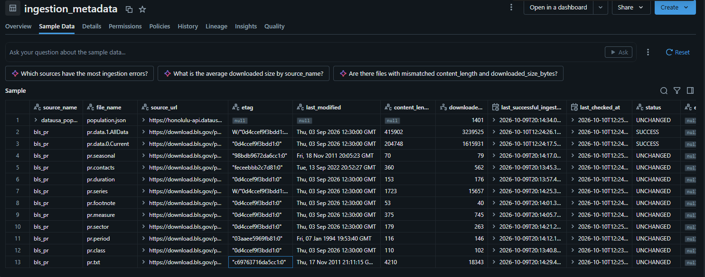
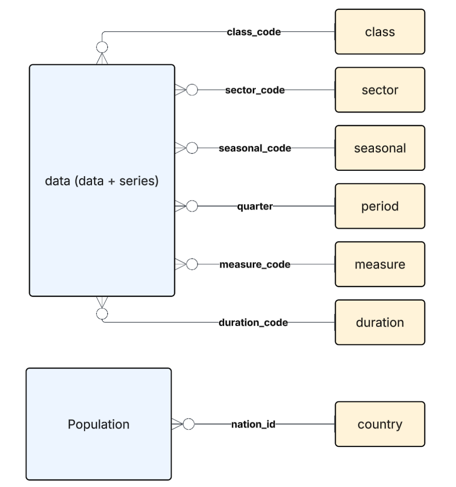

# Jayson Yurcho Rearc Data Engineering Test
## Architecture
The architecture of this data pipeline follows a tradtional medallion architecture.

Source - In this case, the BLS data folder and US Population API.
Raw - Databricks volume located at workspace.raw.bls which stores raw files ingestes from sources. 
Bronze - A 1:1 copy of the source data. Schema and data are unchanged. 
Silver - Cleaned version of data. Null checks are performed here. 
Gold - Transformed and enriched version of data. 

I have built out the Databricks declaritave pieline to mirror the Medallion architecture. 

### Data Ingestion 
####Source to Raw
- Data is ingested from both the BLS site and the us population site via Get API calls.
- All files are saved in raw.BLS volume. 
- Metadata is stored in table in raw. 

- Upon rerun, only files with different ETags will be redownloaded. Missing Etags will go to modified date + size compairson.  
- All new files are always downloaded. 
- Pipeline located here. 

#### Raw to Bronze
Config files govern the Raw to Bronze load. Only files with enabled: True will be brought from raw to Bronze. The field insert_datetime is added to all records. 

#### Bronze to Silver
Config files goveren the Bronze to Silver load. Only files with enabled: True will be brought from Bronze to Silver. Data id deduplicated and checked for nulls at this layer.

#### Silver to Gold
I have built two examples of the Silver to Gold layer in order to satisfy the requirements of this assignment.

#####SQL
- Config files provide the SQL to be ran in order to generate the Gold tables.

#####Pyspark
- Each table gets its own .py file containing the Pyspark necessary to generate theables. 

#### Gold

- The Gold layer is modeled with two 'fact' tables - Data and Population. 
- The Data table can be joined to six dimension talbes, constructed from the BLS data. 
- The Population table only has one Dimensional table, country. 
## Trade-offs
- Data could be appended in bronze, thereby creating historic snapshots. 
## AI Usage
AI was used to generate the initial version of all code. Additionally, it was used in the troubleshooting of errors. 
## Retrospective
I really enjoyed this assignment and learned a few things about Databricks that I did not know before. Personally, the most difficult part was ensuring I included enough functionalinty in the pipeline. Also, the rate limits on the free account prevented me from testing as much as I would have liked. 
## Answers
###PySpark
1. answer
2. answer
3. answer

###SQL
1. answer
2. answer
3. answer