# Rearc Data Engineering Test
## Architecture
The architecture of this data pipeline follows the traditional medallion architecture. I chose this because it is the current data pipeline standard and provides clean layers of functionality that are easy for engineers to understand. 
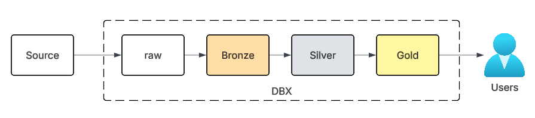
**Source** - In this case, the BLS data folder and US Population APIs act as sources for the pipeline. 
**Raw** - Databricks volume which stores the raw files ingested from sources.  
**Bronze** - The Bronze layer contains a 1:1 copy of the source data. Schema and data are unchanged.   
**Silver** - Sanitized version of data. Null checks and deduplication are performed here.  
**Gold** - Transformed and enriched version of data. Data is fully modeled and consumer-ready at the Gold layer.

I have built out the Databricks declarative pipeline to mirror the medallion architecture. 
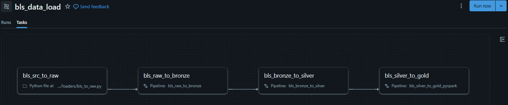
**Please Note:** There are two Silver to Gold layer pipelines available, a PySpark version and a SQL version. 
### Data Ingestion 
#### Source to Raw
- Data is ingested from both the BLS site and the US Population Site via HTTP GET requests.
- All files are saved in raw.BLS volume located at `/Volumes/workspace/raw/bls`. 
- Metadata is stored in the raw schema at `workspace.raw.ingestion_metadata`. 

- Upon rerun, only files with different ETags will be redownloaded. Tables with missing ETags will be compared with modified date + size comparison. This ensures that only new or updated data gets ingested. 
- All new files are always downloaded. 
- Loader is located here `loaders/bls_to_raw.py`.  
- Raw volume and metadata table:  
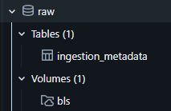

#### Raw to Bronze
- Config files govern the Raw to Bronze load. Config files are located here `config`. Only files with `enabled: True` will be brought from raw to Bronze. The field `insert_datetime` is added to all records for troubleshooting or reporting purposes. A possible functionality expansion could be to store snapshots based on this field.  
- Bronze tables:  
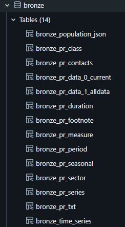

#### Bronze to Silver
- Config files govern the Bronze to Silver load. Config files are located here `config`. Only files with `enabled: True` will be brought from Bronze to Silver. Data is deduplicated and checked for nulls at this layer. Schema is configured in the config files as well.  
- Silver tables:  
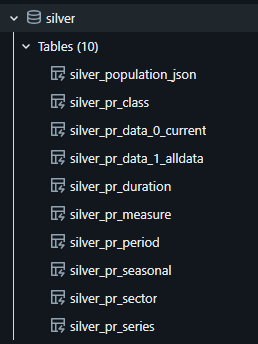

#### Silver to Gold
- I have built two examples of the Silver to Gold layer in order to satisfy the requirements of this assignment. I did not materialize the answers at the Gold layer but rather, built a production-ready data model that provided users with the necessary data for arriving at the answers. See answers section for actual answers.  
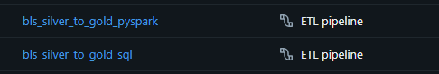

#####SQL
- Config files provide the SQL to be ran in order to generate the Gold tables. Config files are located here `config/gold`. A generic loader loops through the config files and materializes only those with `enabled: True` configured. The SQL query is configurable in the files. 
- Gole SQL tables:  
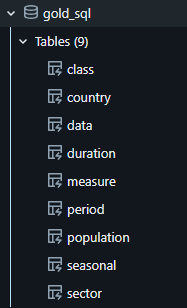

#####PySpark
- Each table gets its own .py file containing the PySpark necessary to generate the tables. Pipeline files are located here `pipeline/bls_silver_to_gold_pyspark`. Personally, I prefer the PySpark approach to the SQL approach. I just prefer working with PySpark in a notebook to SQL in the instance of a DBX pipeline.  
- Gole PySpark tables:  
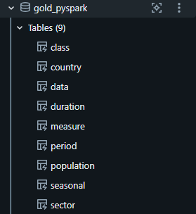

#### Gold

- The Gold layer is modeled with two 'fact' tables - Data and Population. 
- The Data table can be joined to six dimension tables, constructed from the BLS data. 
- The Population table only has one dimension table, country. 
## Trade-offs
In the interest of time, I could not implement all of the enhancements noted below however, the following are ways this could be improved. 
- Data could be appended in bronze, thereby creating historic snapshots utilizing the insert_datetime field. 
- Pipeline code could be source controlled with CI/CD. 
- Resources could be shared across all of Rearc. This way, consultants could save time while utilizing standardized code for specific things. 
- Detailed logging should be added so that any issues can be quickly identified via a simple dashboard or alerts. This will also enable telemetry on the pipeline's function. 
- Cost monitoring could be added to the pipelines. 
## AI Usage
AI was used to generate the initial version of all code. Additionally, it was used in troubleshooting errors. I made the necessary modifications to the generated code myself, as well as providing the overarching design. 
## Retrospective
I really enjoyed this assignment and learned a few things about Databricks that I did not know before. Personally, the most difficult part was ensuring I included enough functionality in the pipeline. Also, the rate limits on the DBX free account prevented me from testing as much as I would have liked. 
## Answers
1. **Mean**: 322,069,808 **STD Dev.**: 4,158,441.04
2. Run code for full answer
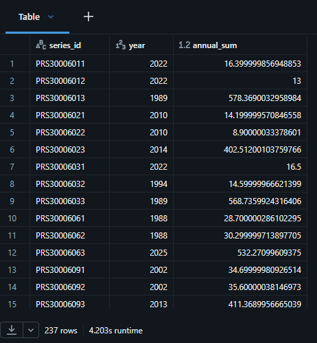
3. The SID PRS30006032 was not present in the data! However, below is an example of the values and previous population values for the SID PRS88003191. We could filter for any other SID and get the appropriate values as well. 
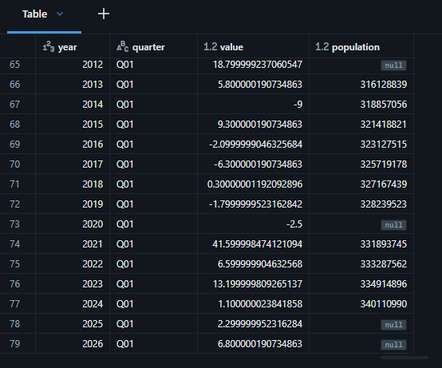
###PySpark
1. 
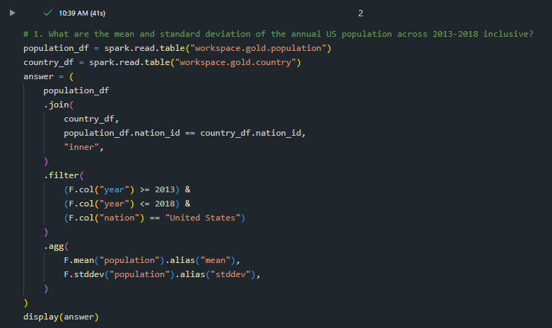
2. Uncomment to add class_text, or join another table for other fields. 
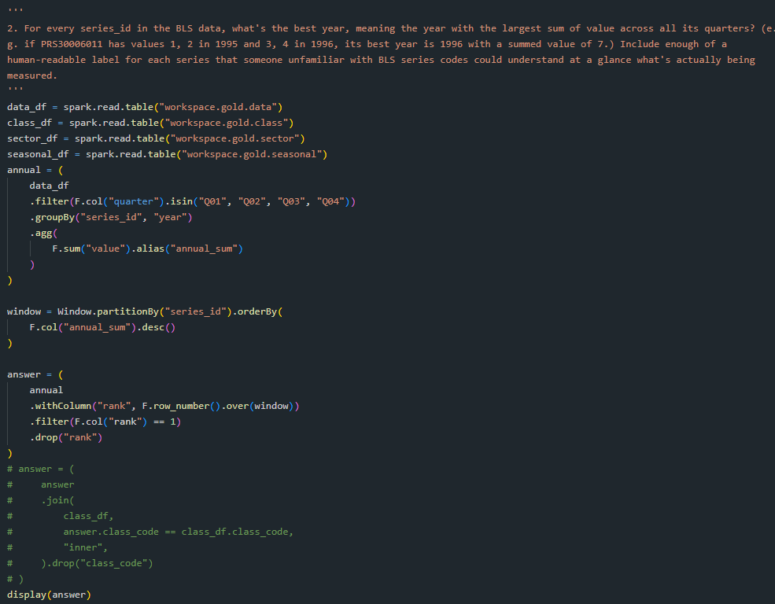
3. 
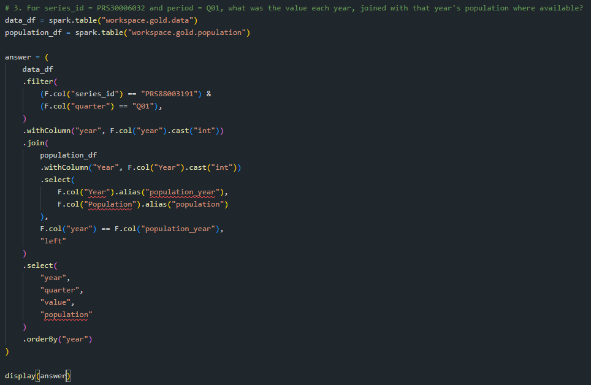

###SQL
1. 
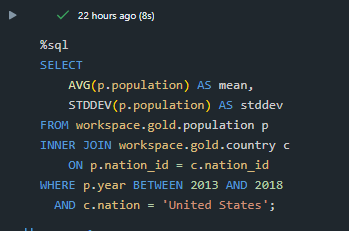

2. 
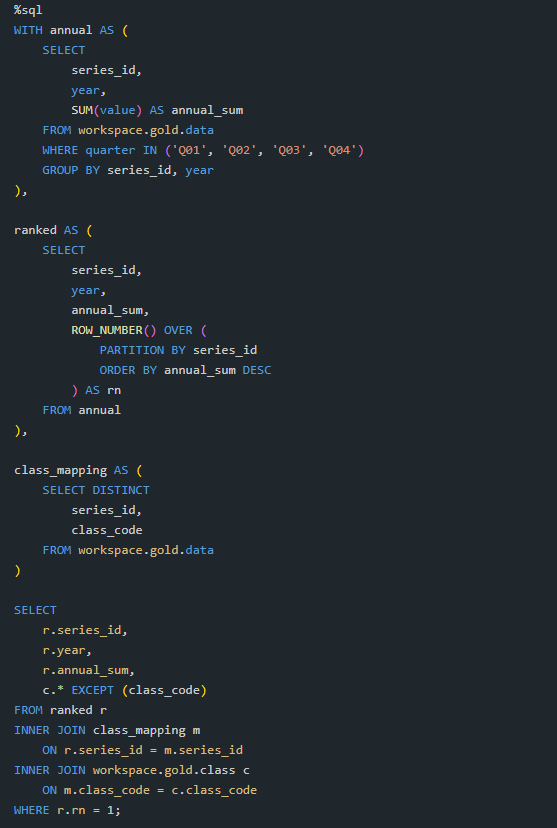

3. 
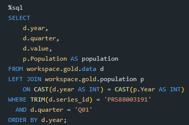

### Dashboard
Using the Gold modeled data, I was able to construct a rudimentary dashboard for users to explore this data. Ideally, I would have met with key business users of the data in order to gather their requirements of what they need in a dashboard. I would then construct the dashboard from there. 
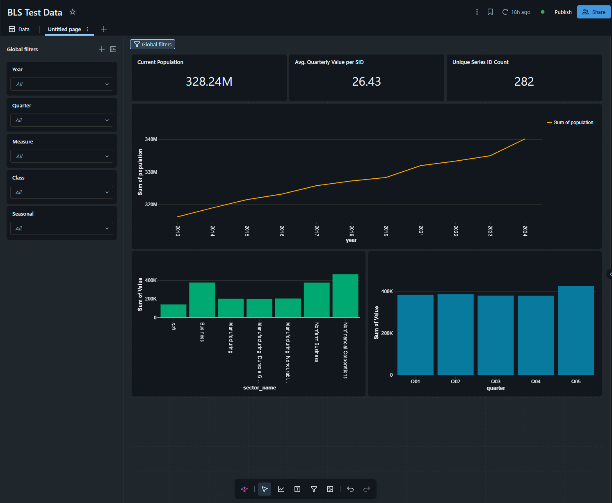
Gold data model in Dashboard section: 
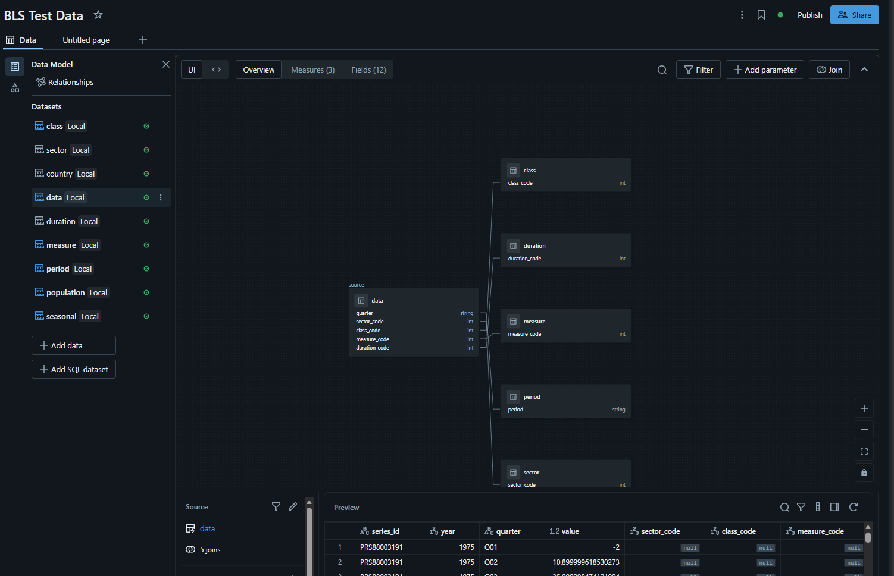